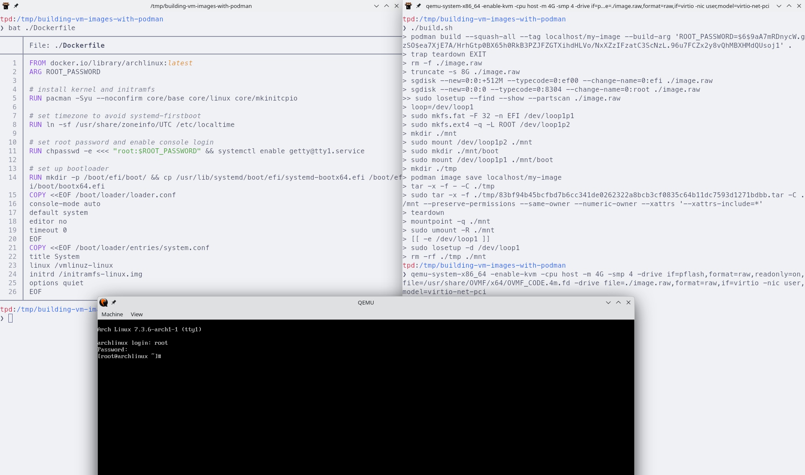

Are you annoyed by Packer and Ansible?
In this blog post I will show how easily a [Dockerfile](https://docs.docker.com/reference/dockerfile/) can be turned into a bootable disk image.
Most of the overhead of Packer and Ansible is suddenly gone.
And you get layer caching for free on top.

## Prerequisites

Throughout this post I use Arch Linux, both as the build host and inside the image, but the idea itself is distro-agnostic.
To install the required packages on Arch, run:

```bash
sudo pacman -S --needed podman gptfdisk dosfstools
```

## The Dockerfile

First of all, the Dockerfile is completely ordinary.
The only unusual requirement is that a bootloader, kernel and initramfs end up in `/boot`.

~~~ dockerfile
FROM docker.io/library/archlinux:latest
ARG ROOT_PASSWORD

# install kernel and initramfs
RUN pacman -Syu --noconfirm core/base core/linux core/mkinitcpio

# set timezone to avoid systemd-firstboot
RUN ln -sf /usr/share/zoneinfo/UTC /etc/localtime

# set root password and enable console login
RUN chpasswd -e <<< "root:$ROOT_PASSWORD" && systemctl enable getty@tty1.service

# set up bootloader
RUN mkdir -p /boot/efi/boot/ && cp /usr/lib/systemd/boot/efi/systemd-bootx64.efi /boot/efi/boot/bootx64.efi
COPY <<EOF /boot/loader/loader.conf
console-mode auto
default system
editor no
timeout 0
EOF
COPY <<EOF /boot/loader/entries/system.conf
title System
linux /vmlinuz-linux
initrd /initramfs-linux.img
options quiet
EOF
~~~

## Building the container

You can build the container image pretty much like you always do.
Only `--squash-all` is important, because the next step expects an image with a single layer.

~~~ bash
root_password=$(openssl passwd -6)
podman build --squash-all --tag localhost/my-image --build-arg ROOT_PASSWORD="${root_password}" .
~~~

If you want to modify `/etc/resolv.conf` or `/etc/hosts` in the Dockerfile, you need to pass the options `--network host --dns none --no-hosts` to `podman build`.

## Turning the container into a disk image

Now the magic happens.
The following commands convert the container image into a raw disk image.
If you ever installed Arch from scratch, most of the steps will be familiar to you.

~~~ bash
# create empty disk
rm -f ./image.raw
truncate -s 8G ./image.raw

# create partitions
sgdisk --new=0:0:+512M --typecode=0:ef00 --change-name=0:efi ./image.raw
sgdisk --new=0:0:0 --typecode=0:8304 --change-name=0:root ./image.raw
sgdisk --sort --print ./image.raw

# attach disk to loop device
loop=$(sudo losetup --find --show --partscan ./image.raw)

# create filesystems
sudo mkfs.fat -F 32 -n EFI ${loop}p1
sudo mkfs.ext4 -q -L ROOT ${loop}p2

# mount filesystems
mkdir ./mnt
sudo mount ${loop}p2 ./mnt
sudo mkdir ./mnt/boot
sudo mount ${loop}p1 ./mnt/boot

# unpack container over mountpoint
mkdir ./tmp
podman image save localhost/my-image | tar -x -f - -C ./tmp
sudo tar -x -f ./tmp/????????????????????????????????????????????????????????????????.tar -C ./mnt --preserve-permissions --same-owner --numeric-owner --xattrs --xattrs-include='*'

# cleanup
rm -rf ./tmp
sudo umount -R ./mnt
sudo losetup -d ${loop}
rmdir ./mnt
~~~

## Why does this even boot?

You might have noticed that the kernel command line is basically empty and that we never touched `/etc/fstab`.
Thanks to the [Discoverable Partitions Specification](https://uapi-group.org/specifications/specs/discoverable_partitions_specification/), neither is needed: Systemd finds the root partition by its type code `8304` and mounts the EFI partition to `/boot` automatically.  
Furthermore, the bootloader is placed at `\EFI\BOOT\BOOTX64.EFI`, the path the UEFI firmware automatically falls back to, so no boot entry has to be registered.

## Testing the disk image

Finally, you can boot the disk image in a VM.
The OVMF path below is where Arch stores the firmware; other distros use different paths.

~~~ bash
sudo pacman -S --needed qemu-system-x86 edk2-ovmf
qemu-system-x86_64 -enable-kvm -cpu host -m 4G -smp 4 -drive if=pflash,format=raw,readonly=on,file=/usr/share/OVMF/x64/OVMF_CODE.4m.fd -drive file=./image.raw,format=raw,if=virtio -nic user,model=virtio-net-pci
~~~



## Conclusion

You can find the final script on [GitHub](https://gist.github.com/dadevel/1e3f8914df81523ade42f316a43c8cc0).
With a few dozen shell commands you get a ready-to-use disk image.
No Packer template and no Ansible playbook needed.
A VM is never even booted during the build process.  
However, this is just a demonstration of the core idea.
If you need something more complete, take a look at [bootc](https://github.com/bootc-dev/bootc) and [bootc-image-builder](https://github.com/osbuild/image-builder).
They also turn container images into bootable disks and add atomic updates on top, but they require base images built specifically for bootc, while the simple approach above works with any ordinary container image.
